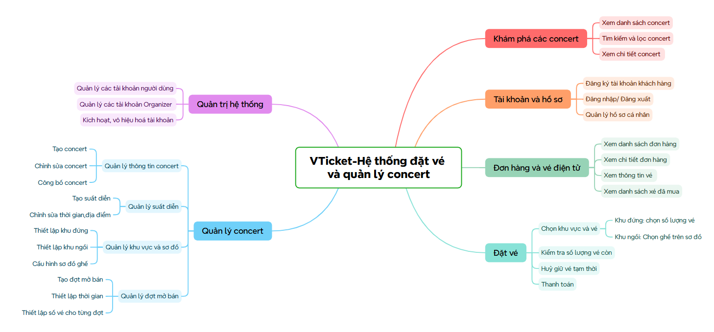
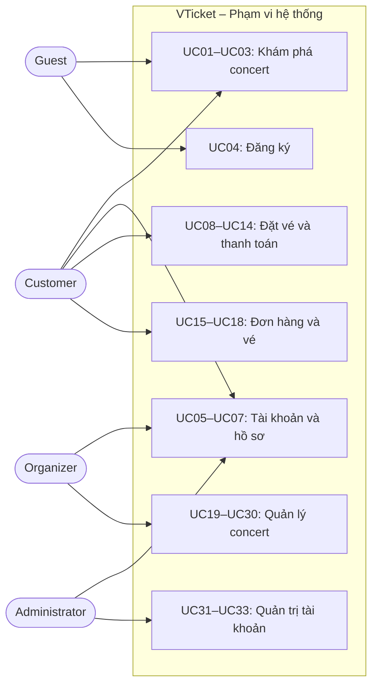
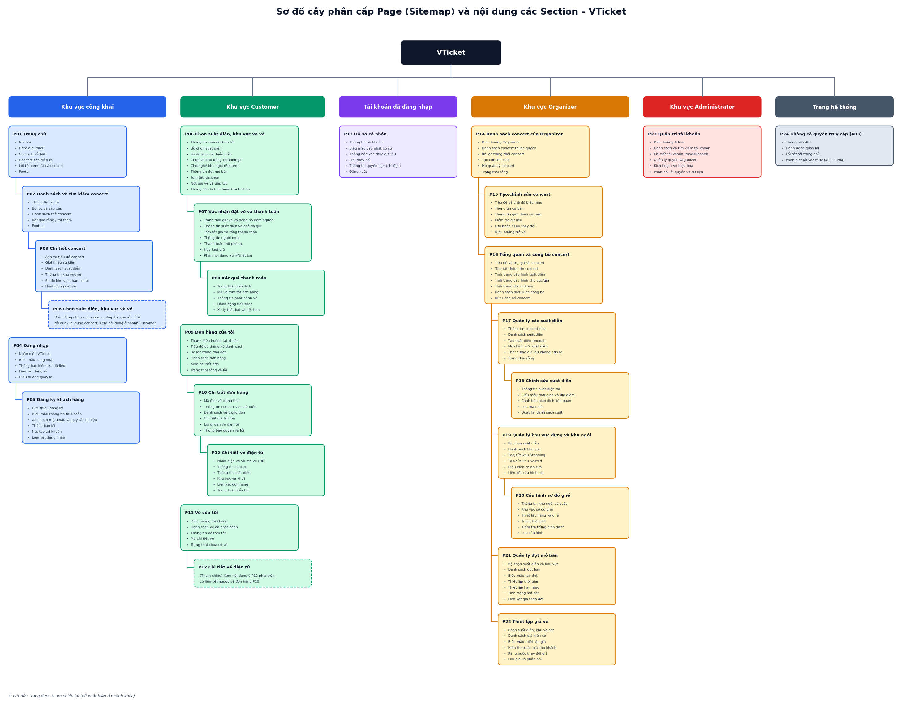

# VTicket

**VTicket - Hệ thống đặt vé và quản lý concert** là đề tài phần mềm hỗ trợ khán giả tìm kiếm sự kiện âm nhạc, đặt vé trực tuyến và sử dụng vé điện tử khi tham dự. Ban tổ chức có thể tạo concert, cấu hình các hạng vé/khu vực, theo dõi tình hình bán vé; quản trị viên quản lý tài khoản và quyền truy cập.

## 1. Requirements - INVEST, Use Cases, and Acceptance Criteria

Phần này xác định hệ thống phải cung cấp chức năng gì, ai tương tác với hệ thống và điều kiện nào được dùng để xác nhận chức năng hoạt động đúng. **User Story (US)** mô tả nhu cầu từ góc nhìn người dùng; **Acceptance Criteria (AC)** mô tả kết quả có thể kiểm thử; **Use Case (UC)** mô tả trình tự tương tác giữa tác nhân và hệ thống.

### 1.1. Product Mind Map



| Nhóm nghiệp vụ | Mô tả |
| --- | --- |
| Concert và suất diễn | Một concert có thể có nhiều suất diễn, mỗi suất có thời gian/địa điểm và khả năng đặt chỗ độc lập. |
| Khu đứng (`STANDING`) | Không đánh số ghế; khách chọn khu và số lượng, hệ thống kiểm soát sức chứa còn lại. |
| Khu ngồi (`SEATED`) | Có sơ đồ ghế; khách chọn hàng/ghế cụ thể. Ghế có thể ở trạng thái còn trống, đang giữ hoặc đã bán. |
| Đợt mở bán | Ban tổ chức thiết lập thời gian và hạn mức vé cho mỗi đợt; ví dụ có thể đặt tên Early Bird hoặc General Sale. |
| Đặt vé | Khách lựa chọn suất diễn, khu vực/số ghế, giữ chỗ tạm thời, hủy lượt giữ hoặc thanh toán. |
| Đơn hàng và vé điện tử | Khách xem đơn hàng và từng vé đã mua, gồm mã vé, suất diễn, khu vực và hàng/ghế nếu có. |
| Quản trị | Admin quản lý tài khoản hệ thống; Organizer chỉ quản lý concert thuộc quyền của mình. |

### 1.2. Yêu cầu theo nguyên tắc INVEST

#### 1.2.1. Nguyên tắc INVEST

| Tiêu chí | Ý nghĩa | 
| --- | --- | --- |
| **I – Independent (Độc lập)** | Mỗi User Story nên có mục tiêu riêng, giảm phụ thuộc không cần thiết. | 
| **N – Negotiable (Có thể thương lượng)** | Có thể trao đổi cách thực hiện, miễn đáp ứng giá trị cốt lõi. |
| **V – Valuable (Có giá trị)** | Story mang lại kết quả hữu ích cho một tác nhân. | 
| **E – Estimable (Có thể ước lượng)** | Đầu vào, đầu ra, quyền hạn và ngoại lệ đủ rõ để dự kiến công sức. | 
| **S – Small (Đủ nhỏ)** | Story mô tả một khả năng chính, không ôm nhiều chức năng độc lập. | 
| **T – Testable (Có thể kiểm thử)** | Có các tiêu chí chấp nhận quan sát và kiểm chứng được. | 

#### 1.2.2. Danh sách User Stories

| ID | Tác nhân | User Story |
| --- | --- | --- |
| **US01** | Guest / Customer | Tôi muốn xem danh sách concert công khai để khám phá sự kiện phù hợp. |
| **US02** | Guest / Customer | Tôi muốn tìm kiếm và lọc concert để nhanh chóng tìm sự kiện mong muốn. |
| **US03** | Guest / Customer | Tôi muốn xem chi tiết concert và các suất diễn để lựa chọn sự kiện phù hợp. |
| **US04** | Guest | Tôi muốn đăng ký tài khoản khách hàng để có thể đặt vé. |
| **US05** | Người có tài khoản | Tôi muốn đăng nhập để sử dụng các chức năng được cấp quyền. |
| **US06** | Người đã đăng nhập | Tôi muốn đăng xuất để kết thúc phiên truy cập trên thiết bị. |
| **US07** | Người đã đăng nhập | Tôi muốn cập nhật hồ sơ cá nhân để giữ thông tin liên hệ chính xác. |
| **US08** | Customer | Tôi muốn chọn một suất diễn để đặt đúng ngày và giờ tham dự. |
| **US09** | Customer | Tôi muốn chọn số lượng vé ở khu đứng để đặt chỗ cho nhóm của mình. |
| **US10** | Customer | Tôi muốn chọn ghế trên sơ đồ khu ngồi để biết chính xác vị trí tham dự. |
| **US11** | Customer | Tôi muốn xem số vé/ghế còn khả dụng trước khi đặt để tránh chọn chỗ đã hết. |
| **US12** | Customer | Tôi muốn giữ tạm những chỗ đã chọn để có thời gian thanh toán. |
| **US13** | Customer | Tôi muốn hủy lượt giữ vé chưa thanh toán để giải phóng chỗ không mua nữa. |
| **US14** | Customer | Tôi muốn thanh toán để hoàn tất đặt vé và nhận xác nhận đơn hàng. |
| **US15** | Customer | Tôi muốn xem danh sách đơn hàng để theo dõi các lần đặt vé. |
| **US16** | Customer | Tôi muốn xem chi tiết đơn hàng để kiểm tra số lượng, giá và trạng thái thanh toán. |
| **US17** | Customer | Tôi muốn xem danh sách vé đã mua để tìm được vé của mình. |
| **US18** | Customer | Tôi muốn xem thông tin từng vé để biết suất diễn, khu vực và vị trí ghế nếu có. |
| **US19** | Organizer | Tôi muốn tạo concert ở trạng thái nháp để chuẩn bị thông tin sự kiện. |
| **US20** | Organizer | Tôi muốn chỉnh sửa thông tin concert của mình để bảo đảm nội dung chính xác. |
| **US21** | Organizer | Tôi muốn công bố concert khi đã cấu hình hợp lệ để khách hàng có thể xem và đặt vé. |
| **US22** | Organizer | Tôi muốn tạo suất diễn để xác định thời gian biểu diễn và phân phối vé riêng cho từng suất. |
| **US23** | Organizer | Tôi muốn chỉnh sửa thời gian và địa điểm suất diễn chưa phát sinh giao dịch để cập nhật lịch trình. |
| **US24** | Organizer | Tôi muốn thiết lập khu đứng và sức chứa để kiểm soát lượng vé được bán. |
| **US25** | Organizer | Tôi muốn thiết lập khu ngồi để phân chia chỗ tham dự có đánh số. |
| **US26** | Organizer | Tôi muốn cấu hình sơ đồ ghế để khách có thể chọn từng ghế cụ thể. |
| **US27** | Organizer | Tôi muốn tạo đợt mở bán để phân chia kế hoạch bán vé. |
| **US28** | Organizer | Tôi muốn thiết lập thời gian cho từng đợt để giới hạn thời điểm đặt vé. |
| **US29** | Organizer | Tôi muốn thiết lập số vé phân bổ cho từng đợt để kiểm soát hạn mức bán. |
| **US30** | Organizer | Tôi muốn thiết lập giá vé theo khu vực/đợt bán để người mua biết số tiền phải trả. |
| **US31** | Administrator | Tôi muốn quản lý các tài khoản người dùng để kiểm soát người truy cập nền tảng. |
| **US32** | Administrator | Tôi muốn quản lý tài khoản Organizer để xác định ai có quyền tổ chức concert. |
| **US33** | Administrator | Tôi muốn kích hoạt hoặc vô hiệu hóa tài khoản để kiểm soát quyền sử dụng hệ thống. |


#### 1.2.3. Rà soát tính INVEST của các nhóm Story

| Nhóm User Story | I – Phụ thuộc cần thiết | N – Phần có thể thay đổi | V – Giá trị | E/S – Ranh giới ước lượng và độ nhỏ | T – Cách kiểm thử |
| --- | --- | --- | --- | --- | --- |
| **US01–US03** Khám phá | Không cần đăng nhập; chi tiết cần concert công khai | Từ khóa, bộ lọc, cách sắp xếp | Tìm concert phù hợp | Tách xem danh sách, tìm kiếm và chi tiết | Concert ẩn không lộ; lọc đúng; trang rỗng đúng |
| **US04–US07** Tài khoản | Đăng xuất và hồ sơ cần đăng nhập | Bố cục form, trường hồ sơ cho phép | Truy cập an toàn | Mỗi Story là một thao tác chính | Trùng email, sai mật khẩu, thiếu quyền |
| **US08–US11** Chọn chỗ | Có concert/suất và cấu hình khu vực | Sơ đồ trực quan, cách hiển thị trạng thái | Chọn đúng suất, khu, ghế | Khu đứng khác khu ngồi; không gộp chọn và giữ | Không chọn ghế đã bán; suất độc lập |
| **US12–US14** Đặt/thanh toán | Thanh toán cần lượt giữ còn hạn | Thời hạn giữ và bố cục thanh toán có thể thống nhất lại | Đặt được chỗ mà không bị bán trùng | Mỗi bước có kết quả riêng; xử lý đồng thời cần kiểm thử riêng | Hết hạn, vượt sức chứa, trả tiền hai lần |
| **US15–US18** Đơn/vé | Đơn và vé phụ thuộc giao dịch mua | Cách trình bày danh sách/chi tiết | Theo dõi giao dịch và vé mua | Tách danh sách với xem chi tiết | Không xem được dữ liệu người khác |
| **US19–US26** Concert/suất/khu | Cần quyền Organizer; công bố cần cấu hình hợp lệ | Form tạo, cách vẽ sơ đồ ghế | Tổ chức bán vé theo chỗ | Tách tạo/sửa/công bố và từng loại khu | Dữ liệu sai, sửa trái quyền, phá vỡ ghế đã bán |
| **US27–US30** Đợt mở bán | Cần suất, khu và số lượng phù hợp | Tên đợt, bố cục lịch mở bán | Phân phối vé theo từng thời điểm | Chia tạo đợt, thời gian, hạn mức, giá | Ngoài giờ, vượt hạn mức, giá sai |
| **US31–US33** Quản trị | Cần Admin đăng nhập | Giao diện danh sách/form quản lý | Kiểm soát truy cập | Tách quản lý người dùng, cấp quyền Organizer, trạng thái | Người không phải Admin bị từ chối |

#### 1.2.4. Quy tắc nghiệp vụ (Business Rules)

| Mã | Quy tắc thiết kế |
| --- | --- |
| **BR01** | Chỉ concert đã công bố mới xuất hiện trong danh sách công khai. |
| **BR02** | Mỗi concert có ít nhất một suất diễn để mở bán; số vé và trạng thái ghế được quản lý **độc lập theo từng suất**. |
| **BR03** | Khu đứng bán theo số lượng; số vé đã bán cộng số vé đang được giữ còn hạn không vượt sức chứa. |
| **BR04** | Khu ngồi bán theo ghế; một ghế chỉ được giữ hoặc bán cho tối đa một đơn trong cùng suất diễn. |
| **BR05** | Khách chỉ được đặt khi đợt bán phù hợp đang mở và còn hạn mức phân bổ. |
| **BR06** | Mỗi lượt giữ có thời hạn **10 phút** (giả định thiết kế có thể điều chỉnh); thời điểm hết hạn do máy chủ xác định. |
| **BR07** | Khách có thể hủy lượt giữ chưa thanh toán khi không có yêu cầu thanh toán đang xử lý; đơn chưa thanh toán gắn với lượt giữ đó, nếu có, chuyển sang `CANCELLED`. Lượt giữ hết hạn tự mất hiệu lực; đơn chưa thanh toán tương ứng chuyển sang `EXPIRED` và chỗ có thể đặt lại. |
| **BR08** | Khi một yêu cầu giữ nhiều ghế, hệ thống chỉ chấp nhận nếu **tất cả** ghế đều còn khả dụng; không giữ một phần âm thầm. |
| **BR09** | Giá vé và hạn mức bán được xác định ở Backend theo suất, khu và đợt; trình duyệt không được tự quyết định giá cuối cùng. Giá được ghi nhận khi giữ vé thành công và giữ nguyên trong thời hạn lượt giữ; đơn hàng sử dụng giá đã ghi nhận này. |
| **BR10** | Thanh toán được **mô phỏng** trong bản thiết kế này; chỉ kết quả thành công trên lượt giữ hợp lệ mới phát hành vé và xác nhận đơn. |
| **BR11** | Gửi lại cùng yêu cầu thanh toán không được tạo đơn và phát hành vé trùng. |
| **BR12** | Mỗi vé phát hành có một mã vé riêng; vé gắn với **một suất diễn**, một khu vực và một vị trí ghế nếu là khu ngồi. |
| **BR13** | Organizer chỉ được quản lý concert, suất diễn, khu vực và đợt mở bán của mình. |
| **BR14** | Không cho phép sửa hoặc xóa cấu trúc ghế, sức chứa, giá đã cam kết theo cách làm sai thông tin vé và đơn hàng đã phát sinh. |
| **BR15** | Chỉ Admin được quản lý cấp quyền Organizer và vô hiệu hóa tài khoản. Tài khoản bị vô hiệu hóa bị từ chối ở các chức năng yêu cầu đăng nhập. |
| **BR16** | Phân bổ vé theo đợt bán không được khiến tổng số chỗ đã bán/đang giữ vượt sức chứa vật lý của suất diễn. |
| **BR17** | Giữ vé thành công chưa tạo đơn hàng. Lần xác nhận thanh toán đầu tiên trên lượt giữ hợp lệ tạo đơn `PENDING`; mỗi lượt giữ gắn với tối đa một đơn. Thành công chuyển đơn sang `PAID`; thất bại chuyển sang `FAILED`. Thử lại khi lượt giữ còn hạn chuyển chính đơn đó từ `FAILED` sang `PENDING`, không tạo đơn mới hoặc gia hạn giữ. |
| **BR18** | Các thao tác thanh toán, hủy và hết hạn phải kiểm tra và cập nhật nhất quán trạng thái đơn/lượt giữ. Không hủy hoặc gửi thêm lần thanh toán khi đang xử lý; kết quả đến sau khi lượt giữ hết hạn không được chuyển đơn sang `PAID` hoặc phát hành vé. Đơn `PAID`, `CANCELLED`, `EXPIRED` không được thanh toán lại. |

#### 1.2.5. Acceptance Criteria (AC – Tiêu chí chấp nhận)

| Mã AC | Tiêu chí chấp nhận |
| --- | --- |
| **AC01** | Chỉ hiển thị concert đã công bố; có danh sách và trạng thái không có concert phù hợp. |
| **AC02** | Tìm kiếm/lọc theo thông tin hợp lệ trả kết quả đúng; bộ lọc kết hợp nhất quán; trường hợp không có kết quả hiển thị rõ. |
| **AC03** | Chi tiết concert có thông tin sự kiện và các suất diễn; concert chưa công bố không được truy cập công khai. |
| **AC04** | Dữ liệu đăng ký hợp lệ tạo tài khoản Customer; email đã tồn tại hoặc thiếu thông tin bắt buộc bị từ chối. |
| **AC05** | Người có tài khoản hoạt động đăng nhập thành công; thông tin sai hoặc tài khoản bị vô hiệu hóa không được truy cập. |
| **AC06** | Sau đăng xuất, thiết bị xóa phiên đang dùng và yêu cầu xác thực lại khi vào trang bảo vệ. |
| **AC07** | Người dùng xem và sửa các trường hồ sơ cho phép; không thể tự đổi quyền hoặc trạng thái tài khoản. |
| **AC08** | Khách chọn đúng một suất diễn cho lượt đặt; vé của suất khác không bị trộn trong cùng lựa chọn. |
| **AC09** | Với khu Standing, chỉ nhận số lượng nguyên dương, không vượt số lượng khả dụng và giới hạn đặt được cấu hình. |
| **AC10** | Khu Seated hiển thị ghế theo hàng/vị trí; ghế đã bán/đang giữ không được chọn để giữ thành công; ghế thuộc đúng suất. |
| **AC11** | Hiển thị số vé Standing còn khả dụng và trạng thái từng ghế Seated dựa trên dữ liệu hệ thống; trước khi giữ phải kiểm tra lại phía máy chủ. |
| **AC12** | Giữ vé thành công tạo một lượt giữ còn hạn; khi hai khách tranh chấp chỗ cuối cùng, không thể cả hai cùng giữ thành công; giữ nhiều ghế là toàn bộ hoặc không có. |
| **AC13** | Chỉ chủ lượt giữ còn hiệu lực, chưa thanh toán và không đang xử lý thanh toán có thể hủy; chỗ được giải phóng và đơn liên quan, nếu có, chuyển sang `CANCELLED`; lặp yêu cầu hủy không làm tăng số vé khả dụng quá giới hạn. |
| **AC14** | Lần xác nhận thanh toán đầu tiên tạo đúng một đơn `PENDING` cho lượt giữ hợp lệ. Thành công chuyển đơn sang `PAID` và phát hành đúng số vé; thất bại chuyển sang `FAILED`, thử lại dùng cùng đơn khi lượt giữ còn hạn. Hết hạn chuyển đơn chưa thanh toán sang `EXPIRED`; gửi lặp hoặc kết quả đến muộn không tạo thêm đơn/vé hay phát hành vé trên lượt giữ hết hạn. |
| **AC15** | Customer chỉ xem được danh sách đơn hàng thuộc tài khoản mình. |
| **AC16** | Chi tiết đơn hàng hiển thị concert, suất diễn, khu vực, số lượng/ghế, đơn giá, tổng tiền và trạng thái; chỉ đơn `PAID` có mã vé và liên kết vé điện tử. Khách khác không được đọc. |
| **AC17** | Danh sách vé chỉ chứa các vé đã phát hành thuộc Customer; thể hiện được concert và suất diễn tương ứng. |
| **AC18** | Mỗi vé có mã duy nhất, thông tin suất diễn/khu vực; khu Seated hiển thị hàng/ghế, khu Standing không yêu cầu số ghế. |
| **AC19** | Organizer tạo được concert nháp hợp lệ; concert nháp chưa xuất hiện ở khu vực công khai. |
| **AC20** | Organizer chỉ sửa concert của mình; thông tin không hợp lệ bị từ chối; sửa đổi không làm sai giao dịch đã phát sinh. |
| **AC21** | Chỉ công bố khi concert có thông tin tối thiểu, suất diễn, khu vực, giá và đợt bán hợp lệ; sau công bố khách có thể xem concert. |
| **AC22** | Organizer tạo suất diễn với thời gian/địa điểm hợp lệ; số vé/ghế được quản lý riêng cho từng suất. |
| **AC23** | Chỉ chỉnh sửa suất diễn thuộc concert của mình; thay đổi thời gian/địa điểm bị từ chối nếu ảnh hưởng vé/đơn đã phát sinh theo chính sách. |
| **AC24** | Khu đứng có tên và sức chứa hợp lệ; không giảm sức chứa xuống thấp hơn số vé đã bán + lượt giữ còn hạn. |
| **AC25** | Khu ngồi có tên, thuộc suất diễn và hỗ trợ quản lý danh sách ghế; không trộn chỗ của khu khác. |
| **AC26** | Mỗi ghế có vị trí định danh duy nhất trong phạm vi khu/suất; không xóa/đổi ghế đã bán hoặc đang giữ gây mất dữ liệu giao dịch. |
| **AC27** | Organizer tạo được đợt mở bán cho suất/khu do mình quản lý; dữ liệu đợt không hợp lệ bị từ chối. |
| **AC28** | Thời gian bắt đầu/kết thúc hợp lệ; ngoài khoảng thời gian mở bán thì yêu cầu giữ vé thuộc đợt đó bị từ chối. |
| **AC29** | Hạn mức vé phân bổ là số nguyên không âm; yêu cầu vượt hạn mức còn lại của đợt bị từ chối; tổng bán không vượt sức chứa. |
| **AC30** | Giá vé hợp lệ và được hiển thị trước thanh toán; Backend tính tiền theo giá áp dụng, không nhận số tiền tùy ý từ trình duyệt. |
| **AC31** | Chỉ Admin xem/quản lý danh sách tài khoản theo quyền; dữ liệu tài khoản nhạy cảm không được hiển thị. |
| **AC32** | Chỉ Admin được cấp hoặc thu hồi quyền Organizer; người không có quyền không thực hiện được thao tác này. |
| **AC33** | Chỉ Admin được kích hoạt/vô hiệu hóa tài khoản; tài khoản bị vô hiệu hóa không đăng nhập hoặc dùng quyền đã cấp để truy cập API bảo vệ. |

### 1.3. Các ca sử dụng (Use Cases)

#### 1.3.1. Các tác nhân (Actors)

| Tác nhân | Trách nhiệm |
| --- | --- |
| **Guest (Khách vãng lai)** | Xem, tìm kiếm, lọc và xem chi tiết concert công khai; đăng ký tài khoản. |
| **Customer (Khách hàng)** | Chọn suất diễn, khu đứng/số lượng hoặc khu ngồi/ghế, giữ vé, thanh toán, xem đơn và vé của mình. |
| **Organizer (Ban tổ chức)** | Tạo/chỉnh sửa/công bố concert, quản lý suất diễn, khu vực, sơ đồ ghế, đợt bán và giá. |
| **Administrator (Quản trị viên)** | Quản lý tài khoản, cấp quyền Organizer, kích hoạt/vô hiệu hóa tài khoản. |

**Lưu ý:** Guest là trạng thái truy cập chưa đăng nhập, không nhất thiết là một role được lưu trong cơ sở dữ liệu. Không có Actor Check-in Staff trong thiết kế này.

#### 1.3.2. Sơ đồ Use Case tổng quan

Sơ đồ sau chỉ minh họa **nhóm chức năng theo tác nhân** để đối chiếu. Khi vẽ Use Case Diagram UML bằng draw.io, hãy biểu diễn từng UC bằng hình ellipse trong System Boundary và nối với Actor tương ứng; không xem các ô nhóm dưới đây là một sơ đồ UML hoàn chỉnh.



#### 1.3.3. Danh sách Use Cases

| Use Case | Tên ca sử dụng | Actor chính | US liên quan |
| --- | --- | --- | --- |
| UC01 | Xem danh sách concert | Guest, Customer | US01 |
| UC02 | Tìm kiếm và lọc concert | Guest, Customer | US02 |
| UC03 | Xem chi tiết concert | Guest, Customer | US03 |
| UC04 | Đăng ký khách hàng | Guest | US04 |
| UC05 | Đăng nhập | Người có tài khoản | US05 |
| UC06 | Đăng xuất | Người đã đăng nhập | US06 |
| UC07 | Cập nhật hồ sơ cá nhân | Người đã đăng nhập | US07 |
| UC08 | Chọn suất diễn | Customer | US08 |
| UC09 | Chọn số lượng vé khu đứng | Customer | US09 |
| UC10 | Chọn ghế khu ngồi | Customer | US10 |
| UC11 | Xem tình trạng vé/ghế khả dụng | Customer | US11 |
| UC12 | Giữ vé tạm thời | Customer | US12 |
| UC13 | Hủy giữ vé | Customer | US13 |
| UC14 | Thanh toán | Customer | US14 |
| UC15 | Xem danh sách đơn hàng | Customer | US15 |
| UC16 | Xem chi tiết đơn hàng | Customer | US16 |
| UC17 | Xem danh sách vé đã mua | Customer | US17 |
| UC18 | Xem thông tin vé điện tử | Customer | US18 |
| UC19 | Tạo concert | Organizer | US19 |
| UC20 | Chỉnh sửa concert | Organizer | US20 |
| UC21 | Công bố concert | Organizer | US21 |
| UC22 | Tạo suất diễn | Organizer | US22 |
| UC23 | Chỉnh sửa suất diễn | Organizer | US23 |
| UC24 | Thiết lập khu đứng | Organizer | US24 |
| UC25 | Thiết lập khu ngồi | Organizer | US25 |
| UC26 | Cấu hình sơ đồ ghế | Organizer | US26 |
| UC27 | Tạo đợt mở bán | Organizer | US27 |
| UC28 | Thiết lập thời gian đợt bán | Organizer | US28 |
| UC29 | Thiết lập hạn mức vé đợt bán | Organizer | US29 |
| UC30 | Thiết lập giá vé | Organizer | US30 |
| UC31 | Quản lý tài khoản người dùng | Administrator | US31 |
| UC32 | Quản lý tài khoản Organizer | Administrator | US32 |
| UC33 | Kích hoạt/vô hiệu hóa tài khoản | Administrator | US33 |

#### 1.3.4. Đặc tả một số Use Case trọng tâm

**UC10 – Chọn ghế ở khu ngồi**

- **Actor:** Customer.
- **Tiền điều kiện:** Concert được công bố; suất diễn và sơ đồ ghế tồn tại.
- **Luồng chính:** (1) Chọn suất diễn → (2) Mở khu ngồi → (3) Hệ thống hiển thị sơ đồ và trạng thái ghế → (4) Chọn ghế khả dụng → (5) Hệ thống hiển thị danh sách ghế, giá dự kiến và cho phép tiếp tục giữ chỗ.
- **Ngoại lệ:** Ghế không tồn tại hoặc đã được người khác giữ/bán → không cho giữ, yêu cầu chọn lại.
- **Hậu điều kiện:** Khách có danh sách ghế đã chọn trên giao diện; **chưa có quyền giữ** cho đến khi UC12 thành công.

**UC12 – Giữ vé tạm thời**

- **Actor:** Customer.
- **Tiền điều kiện:** Đã đăng nhập; đã chọn suất diễn và số lượng/ghế; đợt mở bán hợp lệ.
- **Luồng chính:** (1) Khách yêu cầu giữ → (2) Hệ thống kiểm tra quyền, thời gian mở bán và hạn mức → (3) Kiểm tra nguyên tử số lượng/ghế khả dụng → (4) Tạo lượt giữ với thời điểm hết hạn → (5) Trả về thông tin giữ vé và thời gian còn lại.
- **Luồng thay thế:** Khách hủy lượt giữ → UC13; hệ thống trả chỗ về khả dụng nếu lượt giữ còn hiệu lực, chưa được thanh toán và không đang xử lý thanh toán. Đơn liên quan, nếu có, chuyển sang `CANCELLED`.
- **Ngoại lệ:** Hết ghế, không đủ số lượng, hết hạn đợt bán hoặc yêu cầu bị tranh chấp đồng thời → không tạo lượt giữ, trả thông báo rõ ràng.
- **Hậu điều kiện:** Nếu thành công, các chỗ được giữ không còn khả dụng cho yêu cầu giữ khác trong thời hạn hiệu lực.

**UC14 – Thanh toán và phát hành vé**

- **Actor:** Customer.
- **Tiền điều kiện:** Lượt giữ thuộc Customer và chưa hết hạn.
- **Luồng chính:** (1) Khách mở P07, xem chỗ đã giữ và tổng tiền theo giá ghi nhận khi giữ vé → (2) Khách xác nhận thanh toán mô phỏng → (3) Hệ thống kiểm tra quyền sở hữu, thời hạn và trạng thái lượt giữ, tạo đơn `PENDING` nếu chưa có → (4) Xử lý thanh toán → (5) Khi thành công và lượt giữ vẫn hợp lệ, chuyển đơn sang `PAID`, lượt giữ sang `CONVERTED`, chỗ sang đã bán và phát hành mã vé riêng → (6) Hiển thị kết quả tại P08.
- **Luồng thay thế:** Thanh toán thất bại chuyển đơn sang `FAILED`; nếu lượt giữ còn hạn, khách quay lại P07 thử lại trên cùng đơn, chuyển đơn về `PENDING` mà không gia hạn giữ.
- **Ngoại lệ:** Lượt giữ hết hạn chuyển đơn chưa thanh toán sang `EXPIRED`; hủy lượt giữ hợp lệ chuyển đơn liên quan sang `CANCELLED`. Yêu cầu lặp trả về trạng thái đơn hiện có, không tạo đơn/vé trùng. Khi chưa xác định được kết quả, hiển thị đang xử lý và đọc lại trạng thái trước khi cho thử lại.
- **Hậu điều kiện:** Mỗi lượt giữ có tối đa một đơn; chỉ đơn `PAID` được phát hành đúng số vé đã mua. Kết quả thanh toán đến sau khi lượt giữ hết hạn không được phát hành vé.

**UC21 – Công bố concert**

- **Actor:** Organizer.
- **Tiền điều kiện:** Organizer sở hữu concert ở trạng thái nháp.
- **Luồng chính:** (1) Organizer chọn Công bố → (2) Hệ thống kiểm tra thông tin concert, suất diễn, khu vực, giá và đợt mở bán → (3) Chuyển concert sang trạng thái công bố → (4) Concert xuất hiện với khách công khai.
- **Ngoại lệ:** Thiếu suất diễn, khu vực, sơ đồ ghế bắt buộc, giá hoặc lịch bán không hợp lệ → từ chối công bố và chỉ ra thông tin cần hoàn thiện.
- **Hậu điều kiện:** Concert sẵn sàng hiển thị công khai; việc có thể mua vé còn phụ thuộc vào thời gian mở bán.

### 1.4. Vai trò và phân quyền (Roles and Permissions)

#### 1.4.1. Ma trận phân quyền

Ký hiệu: **✓** = được phép, **—** = không được phép, **Của mình** = chỉ dữ liệu thuộc tài khoản/concert đang quản lý.

| Chức năng | Guest | Customer | Organizer | Admin |
| --- | :---: | :---: | :---: | :---: |
| Xem danh sách, tìm kiếm, xem chi tiết concert công khai | ✓ | ✓ | ✓ | ✓ |
| Đăng ký tài khoản Customer | ✓ | — | — | — |
| Đăng nhập / Đăng xuất | Đăng nhập nếu có tài khoản | ✓ | ✓ | ✓ |
| Xem/cập nhật hồ sơ cá nhân | — | Của mình | Của mình | Của mình |
| Xem suất diễn, khu vực và sơ đồ khu vực công khai | ✓ | ✓ | ✓ | ✓ |
| Xem trạng thái từng ghế tại trang chọn vé | — | ✓ | — | — |
| Chọn khu đứng/số lượng hoặc ghế ngồi để đặt | — | ✓ | — | — |
| Giữ vé, hủy giữ, thanh toán | — | ✓ | — | — |
| Xem danh sách/chi tiết đơn hàng | — | Của mình | — | — |
| Xem danh sách/thông tin vé đã mua | — | Của mình | — | — |
| Tạo, chỉnh sửa, công bố concert | — | — | Của mình | — |
| Quản lý suất diễn | — | — | Của mình | — |
| Thiết lập khu đứng, khu ngồi, sơ đồ ghế | — | — | Của mình | — |
| Thiết lập giá vé, đợt mở bán, thời gian, hạn mức | — | — | Của mình | — |
| Quản lý tài khoản người dùng | — | — | — | ✓ |
| Cấp hoặc thu hồi quyền Organizer | — | — | — | ✓ |
| Kích hoạt / vô hiệu hóa tài khoản | — | — | — | ✓ |

#### 1.4.2. Các trạng thái nghiệp vụ cần quản lý

| Đối tượng | Trạng thái dự kiến | Ý nghĩa |
| --- | --- | --- |
| Concert | `DRAFT`, `PUBLISHED` | Đang chuẩn bị / đã công bố công khai. |
| Đợt mở bán | Chưa bắt đầu, đang bán, đã kết thúc | Có thể được suy ra từ thời gian đợt bán và trạng thái concert. |
| Ghế theo suất | `AVAILABLE`, `HELD`, `SOLD`, `BLOCKED` | Còn trống / đang giữ / đã bán / không mở bán. |
| Lượt giữ | `ACTIVE`, `CANCELLED`, `EXPIRED`, `CONVERTED` | Còn hạn / đã hủy / hết hạn / đã chuyển thành đơn mua thành công. |
| Đơn hàng | `PENDING`, `PAID`, `FAILED`, `EXPIRED`, `CANCELLED` | Đang xử lý thanh toán / đã thanh toán / thanh toán thất bại / lượt giữ hết hạn / khách đã hủy lượt giữ. |
| Vé điện tử | `ISSUED` | Đã phát hành sau thanh toán |

## 2. Kiến trúc thông tin và phân cấp màn hình

### 2.1. Kiến trúc thông tin (Information Architecture)

#### 2.1.1. Cây phân cấp Page



#### 2.1.2. Nội dung từng Page theo Section

Mỗi Section là một khối nội dung giao diện; các nút, biểu mẫu và phản hồi được mô tả trong khối tương ứng. Modal và panel là thành phần của trang chứa chúng, không được tính thành Page riêng.

##### P01 – Trang chủ

| Section | Mô tả nội dung và chức năng |
| --- | --- |
| **Thanh điều hướng** | Logo VTicket, liên kết danh sách concert và đăng nhập/đăng ký hoặc khu vực tài khoản phù hợp vai trò. |
| **Giới thiệu nền tảng** | Giới thiệu VTicket và nút khám phá concert tại P02. |
| **Concert nổi bật và sắp diễn ra** | Hai nhóm thẻ concert đã công bố, có ảnh, tên và lịch diễn tóm tắt; chọn thẻ mở P03, chọn “Xem tất cả” mở P02. |
| **Chân trang** | Thông tin chung và các liên kết điều hướng. |

##### P02 – Danh sách và tìm kiếm concert

| Section | Mô tả nội dung và chức năng |
| --- | --- |
| **Thanh điều hướng và tiêu đề** | Liên kết trang chủ, tài khoản và tiêu đề danh sách concert. |
| **Tìm kiếm và bộ lọc** | Tìm theo tên concert, lọc theo khoảng ngày diễn và địa điểm; sắp xếp theo thời gian suất diễn sắp tới. |
| **Danh sách kết quả** | Thẻ concert có ảnh, tên, lịch diễn tóm tắt và liên kết P03; dùng phân trang, về trang đầu khi đổi tìm kiếm hoặc bộ lọc. |
| **Phản hồi trạng thái** | Hiển thị đang tải, lỗi tải kèm nút thử lại, hoặc không có kết quả kèm thao tác xóa bộ lọc. |
| **Chân trang** | Thông tin và liên kết chung. |

##### P03 – Chi tiết concert

| Section | Mô tả nội dung và chức năng |
| --- | --- |
| **Điều hướng và giới thiệu concert** | Đường về danh sách, ảnh, tên và nội dung giới thiệu concert đã công bố. |
| **Lịch diễn** | Danh sách suất với ngày, giờ và địa điểm; cho xem trước thông tin từng suất. |
| **Thông tin khu vực vé** | Sơ đồ khu vực tổng thể ở dạng chỉ đọc, loại Standing/Seated, giá và trạng thái mở bán của suất đang xem. |
| **Khu vực đặt vé** | Nút đặt vé dẫn Customer đến P06 và giữ ngữ cảnh concert/suất. Guest đến P04 rồi quay lại; Organizer/Admin chỉ xem thông tin công khai và không có nút đặt vé. |
| **Phản hồi trạng thái và chân trang** | Thông báo khi không tìm thấy concert công khai hoặc không tải được dữ liệu; có liên kết về danh sách. |

##### P04 – Đăng nhập

| Section | Mô tả nội dung và chức năng |
| --- | --- |
| **Nhận diện VTicket** | Tên hệ thống và tiêu đề đăng nhập. |
| **Biểu mẫu đăng nhập** | Email, mật khẩu và nút đăng nhập; lỗi hiển thị tại trường hoặc đầu biểu mẫu, khóa nút khi đang gửi. |
| **Điều hướng tài khoản** | Liên kết P05 và trang công khai. Đăng nhập thành công đưa Customer về concert/suất đang chọn nếu có, Organizer về P14, Admin về P23; Customer không có ngữ cảnh đặt vé về P01. |

##### P05 – Đăng ký khách hàng

| Section | Mô tả nội dung và chức năng |
| --- | --- |
| **Giới thiệu đăng ký** | Nêu mục đích tạo tài khoản Customer. |
| **Biểu mẫu đăng ký** | Họ tên, email, mật khẩu, xác nhận mật khẩu và nút tạo tài khoản; kiểm tra trường bắt buộc, định dạng email và mật khẩu xác nhận. |
| **Phản hồi và điều hướng** | Phân biệt dữ liệu sai với email đã tồn tại; thành công chuyển đến P04 kèm thông báo, giữ ngữ cảnh concert/suất nếu có. Có liên kết đăng nhập cho người đã có tài khoản. |

##### P06 – Chọn suất diễn, khu vực và vé

| Section | Mô tả nội dung và chức năng |
| --- | --- |
| **Thông tin concert và suất diễn** | Tên concert, đường về P03 và bộ chọn suất; đổi suất phải xóa lựa chọn cũ và tải lại dữ liệu chỗ. |
| **Khu vực chọn vé** | Sơ đồ sân khấu/khu vực; Standing chọn số lượng, Seated chọn từng ghế. Chú thích trống/đang chọn/đang giữ/đã bán/khóa bằng màu kèm nhãn hoặc ký hiệu; đang chọn chưa có nghĩa là đã giữ. |
| **Thông tin mở bán** | Hiển thị đợt bán áp dụng, giá và hạn mức còn khả dụng; không cho giữ khi chưa mở bán hoặc đã hết hạn mức. |
| **Tóm tắt đặt vé** | Suất, khu, số lượng/ghế, tổng tiền dự kiến và nút “Giữ vé và tiếp tục”; chỉ chuyển P07 sau khi máy chủ giữ thành công toàn bộ lựa chọn. |
| **Phản hồi trạng thái** | Hiển thị đang tải, đang giữ chỗ, lỗi hoặc hết vé/ghế vừa bị giữ; làm mới tình trạng chỗ và hướng dẫn chọn lại. |

##### P07 – Xác nhận đặt vé và thanh toán

| Section | Mô tả nội dung và chức năng |
| --- | --- |
| **Trạng thái lượt giữ** | Đồng hồ theo thời điểm hết hạn do máy chủ trả về; tải lại trang hoặc thử thanh toán lại không đặt lại đồng hồ. Hết hạn ngăn thanh toán và cho quay P06. |
| **Chi tiết đặt vé** | Concert, suất, khu, số lượng/ghế, đơn giá đã ghi nhận khi giữ và tổng tiền; thông tin người mua lấy từ tài khoản. |
| **Thanh toán mô phỏng** | Nút xác nhận tạo đơn `PENDING` ở lần đầu; thử lại đơn `FAILED` dùng cùng mã đơn khi lượt giữ còn hạn. Kết quả xác định được đưa đến P08. |
| **Hủy lượt giữ** | Nút hủy dùng khi lượt giữ còn hiệu lực và không đang xử lý thanh toán; thành công trả chỗ, chuyển đơn liên quan sang `CANCELLED` nếu có, rồi quay P06. |
| **Phản hồi xử lý** | Trong lúc xử lý, khóa nút thanh toán và hủy. Khi mất kết nối hoặc chưa rõ kết quả, đọc lại trạng thái đơn trước khi cho phép thao tác tiếp. |

##### P08 – Kết quả thanh toán

| Section | Mô tả nội dung và chức năng |
| --- | --- |
| **Kết quả giao dịch** | Hiển thị thành công, thất bại, hết hạn hoặc đã hủy theo trạng thái hệ thống; nếu chưa xác định được kết quả thì hiển thị đang xử lý và đọc lại trạng thái. |
| **Tóm tắt giao dịch** | Mã đơn nếu đã tạo, suất, số lượng và tổng tiền; chỉ thông báo phát hành vé khi đơn `PAID`. |
| **Hành động tiếp theo** | Thành công: mở P10 hoặc P11. Thất bại và lượt giữ còn hạn: về P07 thử lại cùng đơn. Hết hạn/đã hủy: về P06 chọn lại. Đang xử lý: chưa cho gửi lại thanh toán. |

##### P09 – Đơn hàng của tôi

| Section | Mô tả nội dung và chức năng |
| --- | --- |
| **Điều hướng tài khoản** | Liên kết Đơn hàng, Vé của tôi và Hồ sơ. |
| **Tiêu đề và bộ lọc** | Danh sách đơn của tài khoản hiện tại; lọc theo `PENDING`, `PAID`, `FAILED`, `EXPIRED`, `CANCELLED` với nhãn tiếng Việt tương ứng. |
| **Danh sách đơn hàng** | Mã đơn, concert, suất, ngày tạo, tổng tiền và trạng thái; chọn đơn mở P10. Lượt giữ chưa từng xác nhận thanh toán chưa có đơn để liệt kê. |
| **Phản hồi trạng thái** | Hiển thị đang tải, chưa có đơn/không có kết quả lọc hoặc lỗi kèm nút thử lại. |

##### P10 – Chi tiết đơn hàng

| Section | Mô tả nội dung và chức năng |
| --- | --- |
| **Thông tin đơn hàng** | Mã đơn, trạng thái, concert, ngày giờ và địa điểm suất diễn. |
| **Chi tiết đặt vé và giá trị đơn** | Khu vực, số lượng hoặc ghế đã đặt, đơn giá và tổng tiền đã ghi nhận; đơn chưa thanh toán vẫn có thông tin đặt vé nhưng chưa có vé điện tử. |
| **Vé điện tử** | Chỉ hiển thị mã vé và liên kết P12 cho từng vé khi đơn `PAID`. |
| **Thao tác theo trạng thái** | Đơn `FAILED` có lượt giữ còn hạn: về P07 thử lại. Đơn `PENDING`: theo dõi kết quả. Đơn `EXPIRED`/`CANCELLED`: về P06 chọn lại. Có liên kết về P09. |
| **Phản hồi quyền và dữ liệu** | Không tiết lộ đơn của người khác; thông báo khi không tìm thấy đơn hoặc không tải được dữ liệu. |

##### P11 – Vé của tôi

| Section | Mô tả nội dung và chức năng |
| --- | --- |
| **Điều hướng tài khoản** | Liên kết Vé, Đơn hàng và Hồ sơ. |
| **Danh sách vé đã phát hành** | Vé của tài khoản hiện tại, nhận diện theo concert và suất; mỗi thẻ có khu, hàng/ghế nếu có và liên kết P12. |
| **Phản hồi trạng thái** | Hiển thị đang tải, lỗi kèm nút thử lại hoặc chưa có vé kèm liên kết danh sách concert; chỉ lấy vé đã phát hành. |

##### P12 – Chi tiết vé điện tử

| Section | Mô tả nội dung và chức năng |
| --- | --- |
| **Nhận diện vé** | Mã vé duy nhất ở dạng văn bản và trạng thái đã phát hành. |
| **Thông tin tham dự** | Concert, ngày, giờ, địa điểm và khu vực; vé Seated có hàng/số ghế, vé Standing không có số ghế. |
| **Điều hướng liên quan** | Mở đơn tại P10 hoặc về danh sách vé P11. |
| **Phản hồi quyền và dữ liệu** | Chỉ chủ vé được xem; thông báo khi không tìm thấy hoặc không tải được vé. Phạm vi hệ thống không có chức năng quét, xác minh hoặc ghi nhận sử dụng vé. |

##### P13 – Hồ sơ cá nhân

| Section | Mô tả nội dung và chức năng |
| --- | --- |
| **Thông tin tài khoản** | Họ tên, email và thông tin liên hệ; vai trò và trạng thái tài khoản chỉ đọc. |
| **Biểu mẫu cập nhật** | Các trường hồ sơ được phép sửa và nút lưu; hiển thị lỗi tại trường, giữ dữ liệu đã nhập khi lưu thất bại và thông báo khi thành công. |
| **Quản lý phiên** | Nút đăng xuất kết thúc phiên trên thiết bị và đưa về P04; có liên kết về khu vực phù hợp vai trò. |

##### P14 – Danh sách concert của Organizer

| Section | Mô tả nội dung và chức năng |
| --- | --- |
| **Điều hướng Organizer** | Liên kết danh sách concert và hồ sơ cá nhân. |
| **Thanh quản lý concert** | Tìm theo tên, lọc nháp/đã công bố và nút tạo mới dẫn đến P15. |
| **Danh sách concert thuộc quyền** | Chỉ hiển thị concert của Organizer; chọn concert mở P16 để quản lý cấu hình và công bố. |
| **Phản hồi trạng thái** | Đang tải, lỗi kèm nút thử lại hoặc danh sách rỗng kèm hướng dẫn tạo concert. |

##### P15 – Biểu mẫu tạo/chỉnh sửa concert

| Section | Mô tả nội dung và chức năng |
| --- | --- |
| **Tiêu đề và ngữ cảnh** | Phân biệt chế độ tạo mới/chỉnh sửa; hiển thị concert đang sửa. |
| **Thông tin sự kiện** | Tên, mô tả, hình ảnh và nội dung giới thiệu sẽ hiển thị công khai; đánh dấu trường bắt buộc, hiển thị lỗi ngay tại trường. |
| **Thanh thao tác** | Lưu nháp khi tạo mới, lưu thay đổi khi sửa; thành công mở P16. Có nút quay về P14/P16 và cảnh báo khi rời trang còn dữ liệu chưa lưu. |
| **Phản hồi kết quả** | Hiển thị đang lưu, thành công hoặc lỗi; giữ dữ liệu đã nhập khi lỗi và từ chối sửa concert không thuộc quyền. |

##### P16 – Tổng quan và công bố concert

| Section | Mô tả nội dung và chức năng |
| --- | --- |
| **Tổng quan concert** | Tên, chủ sở hữu, trạng thái nháp/đã công bố, thông tin tóm tắt và liên kết chỉnh sửa P15. |
| **Cấu hình suất và vé** | Tóm tắt các suất, khu Standing/Seated, sơ đồ ghế, đợt bán và giá; liên kết P17, P19, P20, P21, P22 với ngữ cảnh tương ứng. |
| **Điều kiện công bố** | Danh sách điều kiện về thông tin concert, suất, khu, sơ đồ ghế bắt buộc, giá và đợt bán; chỉ rõ phần còn thiếu và lối đi để bổ sung. |
| **Công bố và phản hồi** | Nút công bố dùng cho concert nháp; máy chủ kiểm tra điều kiện trước khi công bố. Thành công cập nhật trạng thái và cung cấp liên kết P03; thất bại nêu nguyên nhân. |

##### P17 – Quản lý các suất diễn

| Section | Mô tả nội dung và chức năng |
| --- | --- |
| **Thông tin concert** | Tên concert cha, đường về P16 và nút thêm suất diễn. |
| **Danh sách suất diễn** | Ngày giờ, địa điểm, tình trạng cấu hình; mỗi suất có liên kết sửa tại P18 và cấu hình khu vực tại P19. |
| **Modal tạo suất** | Nhập thời gian, địa điểm và lưu suất mới; báo lỗi trường thiếu/sai, thành công đóng modal và làm mới danh sách. |
| **Phản hồi trạng thái** | Đang tải, lỗi kèm nút thử lại hoặc danh sách rỗng kèm hướng dẫn thêm suất đầu tiên. |

##### P18 – Chỉnh sửa suất diễn

| Section | Mô tả nội dung và chức năng |
| --- | --- |
| **Thông tin suất hiện tại** | Concert, ngày giờ, địa điểm và cảnh báo khi không được sửa vì đã phát sinh đơn/vé. |
| **Biểu mẫu chỉnh sửa** | Thời gian, địa điểm, lỗi từng trường và nút lưu; máy chủ kiểm tra quyền và điều kiện sửa trước khi ghi nhận. |
| **Kết quả và điều hướng** | Thông báo thành công/từ chối; thành công quay về P17 và làm mới dữ liệu, cảnh báo nếu rời trang còn thay đổi chưa lưu. |

##### P19 – Quản lý khu vực đứng và khu ngồi

| Section | Mô tả nội dung và chức năng |
| --- | --- |
| **Ngữ cảnh cấu hình** | Concert, bộ chọn suất và đường về P16/P17; đổi suất tải lại khu vực tương ứng. |
| **Danh sách khu vực** | Tên, loại Standing/Seated, sức chứa hoặc số ghế; liên kết cấu hình ghế P20 cho khu Seated và giá P22 cho từng khu. |
| **Biểu mẫu khu vực** | Tạo/sửa tên và loại khu; Standing nhập sức chứa, Seated cấu hình ghế tại P20. Có nút lưu và lỗi từng trường. |
| **Ràng buộc và phản hồi** | Không giảm sức chứa dưới số đã bán cộng lượt giữ còn hạn hoặc đổi cấu trúc làm sai giao dịch; hiển thị kết quả lưu, lỗi tải và trạng thái chưa có khu. |

##### P20 – Cấu hình sơ đồ ghế

| Section | Mô tả nội dung và chức năng |
| --- | --- |
| **Ngữ cảnh cấu hình** | Khu Seated, suất và concert tương ứng; đường về P19. |
| **Sơ đồ ghế** | Vị trí tương đối, hàng và số ghế; chú thích khả dụng/khóa/đang giữ/đã bán bằng màu kèm nhãn hoặc ký hiệu. |
| **Công cụ cấu hình** | Thêm/sửa hàng và định danh ghế; kiểm tra trùng vị trí trong khu/suất và ngăn đổi ghế đã bán/đang giữ gây sai dữ liệu. |
| **Lưu và phản hồi** | Nút lưu, lỗi cấu hình và kết quả lưu; máy chủ kiểm tra lại giao dịch liên quan trước khi ghi nhận. |

##### P21 – Quản lý đợt mở bán

| Section | Mô tả nội dung và chức năng |
| --- | --- |
| **Ngữ cảnh cấu hình** | Bộ chọn suất và khu vực, đường về P16. |
| **Danh sách đợt bán** | Tên đợt, thời gian bắt đầu/kết thúc, hạn mức và trạng thái chưa bắt đầu/đang bán/đã kết thúc; nút tạo, sửa và liên kết giá P22. |
| **Modal tạo/sửa đợt** | Nhập tên, thời gian và hạn mức cho suất/khu đã chọn; kiểm tra thời gian hợp lệ, số lượng phân bổ và giao dịch đã phát sinh trước khi lưu. |
| **Phản hồi trạng thái** | Đang tải, chưa có đợt hoặc lỗi; lưu thành công đóng modal và cập nhật danh sách, lưu lỗi giữ dữ liệu để chỉnh lại. |

##### P22 – Thiết lập giá vé

| Section | Mô tả nội dung và chức năng |
| --- | --- |
| **Ngữ cảnh cấu hình** | Chọn suất, khu và đợt; hiển thị đường về trang quản lý liên quan. |
| **Danh sách giá và xem trước** | Các mức giá đã cấu hình và cách hiển thị giá cho khách. |
| **Biểu mẫu giá** | Giá trị, đơn vị tiền tệ, nút lưu và lỗi từng trường; không thay đổi giá đã ghi nhận trên lượt giữ còn hạn hoặc đơn hàng đã tạo. |
| **Phản hồi kết quả** | Xác nhận lưu thành công, thông báo dữ liệu không hợp lệ/thiếu quyền hoặc lỗi tải. |

##### P23 – Quản trị tài khoản

| Section | Mô tả nội dung và chức năng |
| --- | --- |
| **Điều hướng Admin** | Liên kết quản lý tài khoản và hồ sơ cá nhân. |
| **Danh sách và tìm kiếm** | Các tài khoản với trường thông tin không nhạy cảm; chọn tài khoản mở panel chi tiết bên cạnh. |
| **Panel chi tiết tài khoản** | Thông tin cơ bản, vai trò, trạng thái và các thao tác cấp/thu hồi quyền Organizer, kích hoạt/vô hiệu hóa. |
| **Hộp thoại xác nhận** | Nêu tài khoản và thay đổi dự kiến trước khi thực hiện thao tác đổi quyền hoặc trạng thái; có nút xác nhận và hủy. |
| **Phản hồi kết quả** | Cập nhật danh sách/panel khi thành công; báo tài khoản không tồn tại, thiếu quyền, thao tác không hợp lệ hoặc lỗi xử lý. |

##### P24 – Không có quyền truy cập (403)

| Section | Mô tả nội dung và chức năng |
| --- | --- |
| **Thông báo quyền truy cập** | Giải thích tài khoản đã đăng nhập không có quyền vào chức năng/dữ liệu; không tiết lộ dữ liệu được bảo vệ. |
| **Điều hướng an toàn** | Nút về khu vực phù hợp vai trò và liên kết trang chủ. Người chưa đăng nhập hoặc phiên không hợp lệ được chuyển P04 thay vì hiển thị trang này. |

### 2.2. Phân rã kiến trúc thông tin và phân cấp màn hình (Screen Hierarchy)

#### 2.2.1. Danh mục màn hình (Screen Inventory)

| Mã | Màn hình / Page | Hình thức hiển thị | Vai trò | US liên quan |
| --- | --- | --- | --- | --- |
| P01 | Trang chủ | Trang | Công khai | US01 |
| P02 | Danh sách và tìm kiếm concert | Trang | Công khai | US01, US02 |
| P03 | Chi tiết concert | Trang | Công khai | US03, US08 |
| P04 | Đăng nhập | Trang | Guest | US05 |
| P05 | Đăng ký khách hàng | Trang | Guest | US04 |
| P06 | Chọn suất diễn, khu vực và vé | Trang tương tác (sơ đồ khu vực/ghế) | Customer | US08–US12 |
| P07 | Xác nhận đặt vé và thanh toán | Trang (đồng hồ giữ vé) | Customer | US12–US14 |
| P08 | Kết quả thanh toán | Trang trạng thái | Customer | US14 |
| P09 | Đơn hàng của tôi | Trang danh sách | Customer | US15 |
| P10 | Chi tiết đơn hàng | Trang chi tiết | Customer | US16 |
| P11 | Vé của tôi | Trang danh sách | Customer | US17 |
| P12 | Chi tiết vé điện tử | Trang chi tiết | Customer | US18 |
| P13 | Hồ sơ cá nhân | Trang biểu mẫu | Người đã đăng nhập | US07, US06 |
| P14 | Danh sách concert của Organizer | Trang danh sách | Organizer | US19–US21 |
| P15 | Biểu mẫu tạo/chỉnh sửa concert | Trang biểu mẫu (tạo/sửa) | Organizer | US19, US20 |
| P16 | Tổng quan và công bố concert | Trang chi tiết và công bố | Organizer | US20, US21 |
| P17 | Quản lý các suất diễn | Trang danh sách + modal tạo | Organizer | US22, US23 |
| P18 | Chỉnh sửa suất diễn | Trang biểu mẫu | Organizer | US23 |
| P19 | Quản lý khu vực đứng và khu ngồi | Trang danh sách + biểu mẫu khu | Organizer | US24, US25, US30 |
| P20 | Cấu hình sơ đồ ghế | Trang cấu hình sơ đồ ghế | Organizer | US26 |
| P21 | Quản lý đợt mở bán | Trang danh sách + modal tạo/sửa đợt | Organizer | US27–US29 |
| P22 | Thiết lập giá vé | Trang cấu hình giá | Organizer | US30 |
| P23 | Quản trị tài khoản | Trang danh sách + panel chi tiết + hộp thoại xác nhận | Admin | US31–US33 |
| P24 | Không có quyền truy cập (403) | Trang thông báo hệ thống | Người không có quyền | Ràng buộc phân quyền |

#### 2.2.2. Luồng điều hướng chính (Navigation Flow)

**Luồng A – Khám phá và đặt vé**

```text
P01 Trang chủ / P02 Danh sách concert
  → P03 Chi tiết concert
  → [Chưa đăng nhập: P04 Đăng nhập → quay lại concert/suất đang chọn]
  → P06 Chọn suất diễn → chọn khu Standing/số lượng hoặc khu Seated/ghế
  → Yêu cầu giữ vé thành công
  → P07 Xem thông tin giữ vé → xác nhận thanh toán khi lượt giữ còn hạn
  → Tạo đơn PENDING (hoặc dùng lại đơn FAILED khi thử lại)
  → P08 Kết quả thanh toán
  → [Thành công] P10 Chi tiết đơn → P12 Vé điện tử
```

**Luồng B – Giữ vé thất bại, hủy hoặc hết hạn**

```text
P06 Chọn vé
  → [Không đủ vé / ghế vừa bị giữ] Thông báo tại P06 → chọn lại
  → [Giữ thành công] P07
      ├── Hủy khi không đang xử lý thanh toán → đơn liên quan thành CANCELLED (nếu có), trả chỗ → P06
      ├── Hết hạn → đơn chưa thanh toán thành EXPIRED (nếu có), ngăn thanh toán → P06
      └── Thanh toán thất bại → đơn FAILED → P08
          ├── Lượt giữ còn hạn → P07 → thử lại cùng đơn, không gia hạn giữ
          └── Lượt giữ hết hạn → quay P06
```

**Luồng C – Xem đơn hàng và vé điện tử**

```text
P09 Đơn hàng của tôi → P10 Chi tiết đơn → [Đơn PAID] P12 Chi tiết vé
P10 [Đơn FAILED, lượt giữ còn hạn] → P07 Thử thanh toán lại
P11 Vé của tôi → P12 Chi tiết vé → P10 Đơn hàng liên quan
```

**Luồng D – Organizer chuẩn bị và công bố concert**

```text
P14 Danh sách concert của tôi
  → P15 Tạo concert nháp
  → P16 Tổng quan và công bố concert
      ├── P17 Danh sách suất → modal tạo suất / P18 Chỉnh sửa suất
      ├── P19 Thiết lập khu Standing / Seated
      │   └── P20 Cấu hình sơ đồ ghế (nếu là Seated)
      ├── P21 Danh sách đợt bán → modal tạo/sửa thời gian, hạn mức
      └── P22 Thiết lập giá vé
  → P16 Kiểm tra điều kiện công bố
  → Công bố concert → P03 hiển thị công khai
```

**Luồng E – Quản trị tài khoản**

```text
Admin đăng nhập (P04)
  → P23 Quản trị tài khoản
      ├── Xem/tìm tài khoản
      ├── Cấp/thu hồi quyền Organizer
      └── Kích hoạt/vô hiệu hóa tài khoản
  → Hiển thị kết quả và làm mới danh sách
